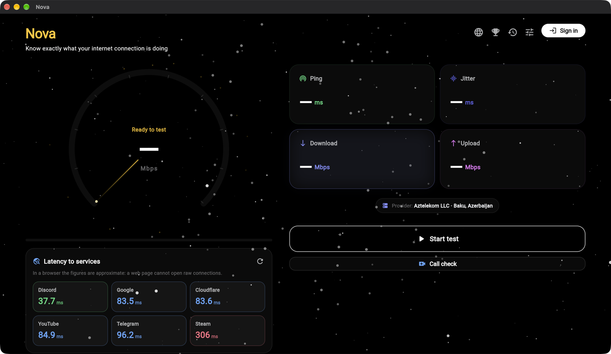
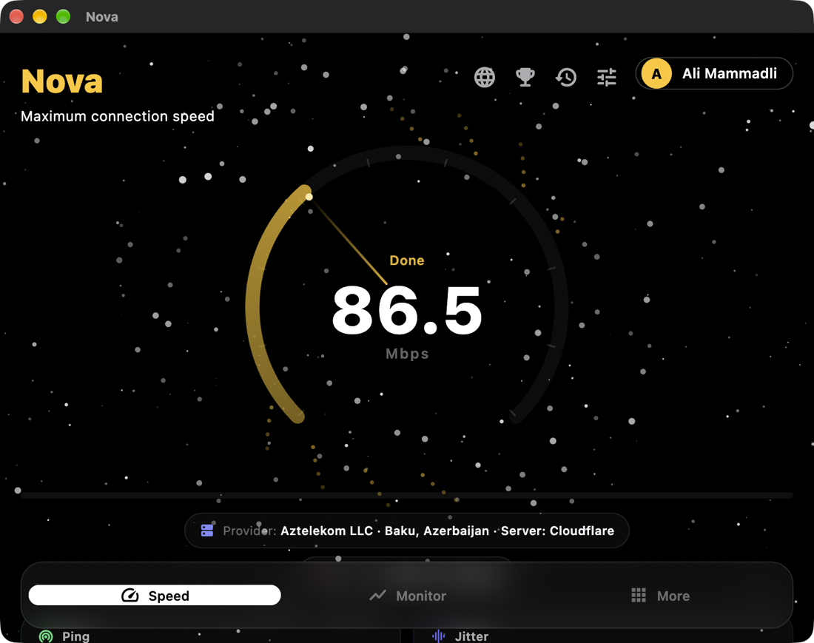
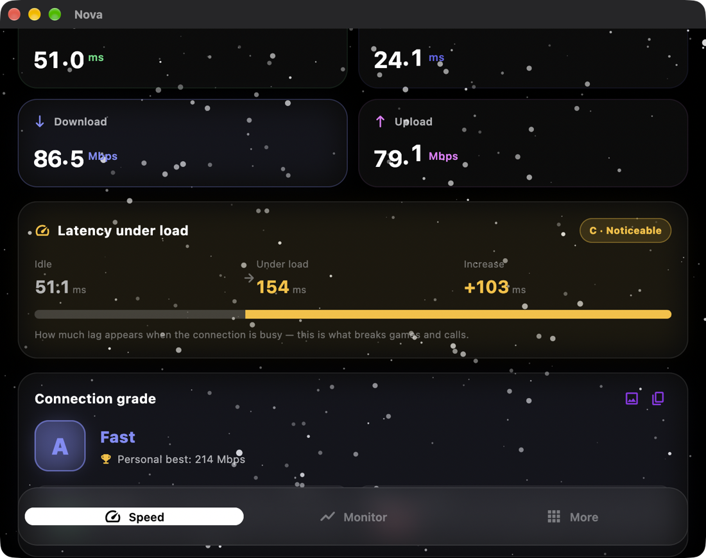
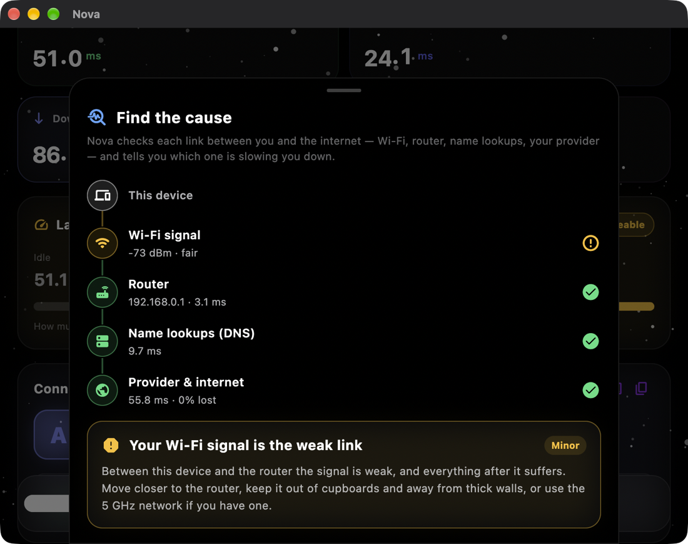
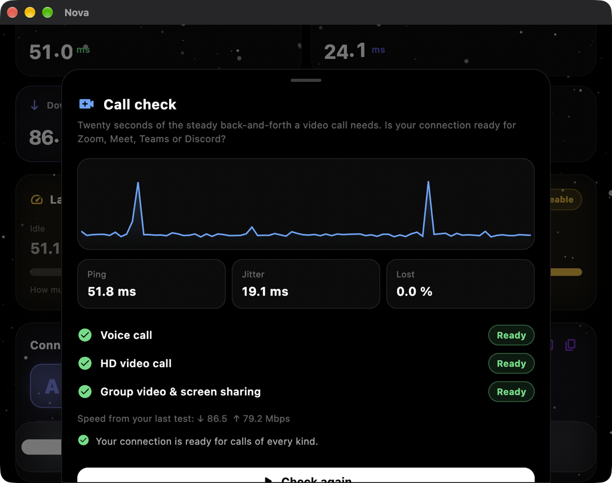
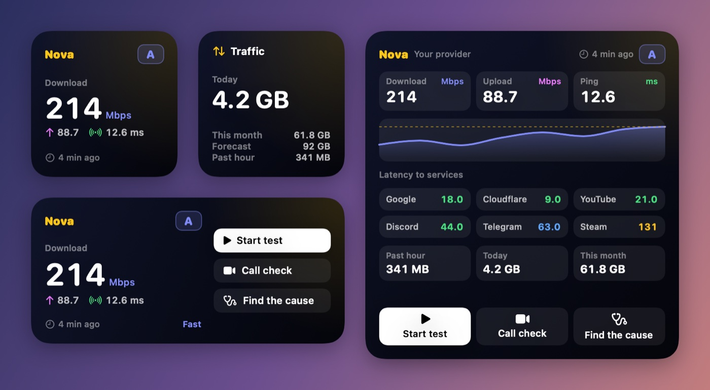
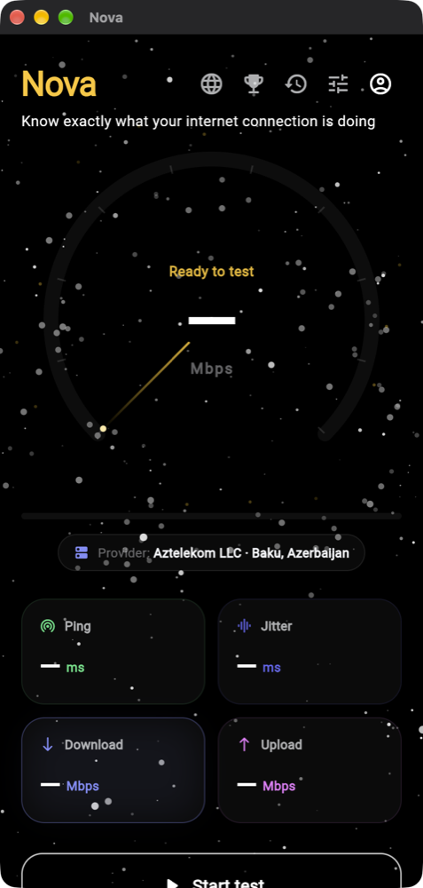

<div align="center">


# Nova

**Know exactly what your internet connection is doing.**

A cross-platform network companion: an accurate speed test and a live
system-wide traffic monitor, in one app.

[](https://github.com/Mammad-Ali/nova/actions/workflows/build.yml)


**[Open in the browser](https://mammad-ali.github.io/nova/)** ·
**[Download for Windows, macOS or Android](#install)**

<br>



</div>

---

## Why another speed test?

Most speed tests answer one question: *how many megabits do I get?* That number
alone rarely explains why a call stutters or why a game lags. Nova measures the
things that actually decide how the connection **feels**:

- **Latency under load (bufferbloat).** Ping is measured *while* the link is
  saturated, not only when idle. This is the single best predictor of laggy
  games and choppy calls, and it is missing from most speed tests.
- **Real-world verdicts.** Results are translated into plain answers: is this
  enough for 4K, for gaming, for streaming?
- **What happens between tests.** A passive monitor keeps watching the link, so
  brief outages and slow hours don't go unnoticed.

## Screenshots

| The app on a Mac | After a test |
|:---:|:---:|
|  |  |
| **Find the cause** | **Call check** |
|  |  |

<p align="center">
  
  <br><sub>Mac widgets — <i>Speed</i>, <i>Traffic</i>, <i>Speed &amp; tools</i> and <i>Dashboard</i></sub>
</p>

<p align="center">
  
  <br><sub>The website on a phone</sub>
</p>

## Features

### Speed test

| | |
|---|---|
| **Download / upload / ping / jitter** | Measured over four parallel connections against public CDNs |
| **Latency under load** | Bufferbloat rating A–D, the metric that predicts lag |
| **Automatic server failover** | Cloudflare → Cachefly → Hetzner; a rate-limited source never breaks a run |
| **Connection grade** | A single A+…E score, plus a plain-language tier |
| **Comfort scale** | Whether the speed suits 4K, gaming, calls, streaming and large downloads |
| **ISP throttling detector** | Compares a neutral CDN against Netflix's CDN to spot video throttling |
| **Latency to services** | Round-trip times to YouTube, Discord, Steam, Cloudflare and more, right on the main screen |
| **Call check** | Twenty seconds of round trips four times a second, judged for voice, HD video and group calls — with a tip for every problem |
| **Find the cause** | Checks the Wi-Fi signal, the router, name lookups and the provider in turn, and names the weak link (apps only) |
| **History** | Every completed run, with a trend chart, personal best and a comparison to the previous run |
| **Sharing** | Copy results as text, save them as an image, export the history to CSV |
| **Google account** | Optional sign-in on every platform, the website included; the test history follows you to every device |
| **Leaderboard** | Best results ranked worldwide, by country or by ISP; only a nickname is shown |
| **Speedometer** | A fixed, numbered scale (0–1 Gbps, 10 Gbps for multi-gig lines); past 100 Mbps the needle glows, past 500 Mbps the backdrop goes to warp speed |
| **Automatic tests** | Optional: a test every 1, 3 or 6 hours, never on mobile data or a hotspot, with a second try when a result comes in under 50 Mbps |

### Traffic monitor

| | |
|---|---|
| **Live throughput** | System-wide Rx/Tx, sampled once per second |
| **Usage totals** | Hour, day and month, with a projection for the end of the month |
| **Connection stability** | A rolling latency chart with packet loss and outage detection |
| **Wi-Fi context** | Signal strength and link rate, so "slow" can be traced to the router |
| **Apps using the network** | Which apps took how much — on the Mac live, with each app's speed right now; on Android for today (needs Usage access) |
| **Who's on my network** | Port sweep, ping sweep, ARP table, SSDP and Bonjour together, so even phones that ignore every port show up — with their name, maker and a guess at what they are |

### Desktop integration

- Live speed in the **menu bar** (macOS) or **tray** (Windows), at a steady width.
  Settings turn it off or choose what it shows: speed and the past hour, speed,
  download and upload, today's traffic or just the icon — in bytes or bits
- **Widgets** on the Mac desktop and in Notification Centre: *Speed*, *Speed & tools*,
  *Dashboard* and *Traffic*. One click runs a test in the background — the widget
  shows "Testing…" and then the result — or opens a call check or "Find the cause"
- **Updates**: the apps check for a new release. On the Mac, *Update now* (or
  *Nova → Check for Updates…*) installs it in place and restarts Nova; on Windows
  and Android the button downloads the installer
- Click the icon for a **compact panel** — full readings without opening the app
- Closing the window keeps monitoring in the background
- Notifications when speed drops below a threshold or a daily limit is reached
- Animations pause automatically when the window is hidden, to spare the battery

### Everywhere

- Five interface languages: **English, Azerbaijani, Russian, German, Hungarian**
- A **More** tab with four sections — *Learn* (key terms, guides, FAQ),
  *Tools* (leaderboard, provider ranking, latency to services), *About*
  (about Nova, privacy, source code) and *Profile* (history, settings, help,
  account). The website shows the same four sections as its footer.
- A single dark theme built for readability against the animated backdrop

## Install

### In the browser — nothing to install

**[mammad-ali.github.io/nova](https://mammad-ali.github.io/nova/)** runs the
speed test right in the page, together with everything a browser can do: the
history with CSV and image export, latency to services, the call check, the
leaderboard and provider ranking, and the Learn, About and Help pages. A
browser cannot read system traffic counters, scan the local network, see
Wi-Fi details, run the throttling check or "Find the cause", so those live in
the app — the site lists them and offers the download for the visitor's own
system. On a laptop or desktop screen the page spreads into two columns.

### The app

These links always point at the newest release:

| Platform | Download | How |
|---|---|---|
| **Windows** | [Nova-Windows-Setup.exe](https://github.com/Mammad-Ali/nova/releases/latest/download/Nova-Windows-Setup.exe) | Run it. No administrator rights needed. |
| **macOS** | [Nova-macOS.dmg](https://github.com/Mammad-Ali/nova/releases/latest/download/Nova-macOS.dmg) | Open it and drag **Nova** onto **Applications**. |
| **Android** | [Nova-Android.apk](https://github.com/Mammad-Ali/nova/releases/latest/download/Nova-Android.apk) | Open it on the phone and tap **Install**. On an older or unusual device use the [universal APK](https://github.com/Mammad-Ali/nova/releases/latest/download/Nova-Android-universal.apk). |

All releases: [github.com/Mammad-Ali/nova/releases](https://github.com/Mammad-Ali/nova/releases).

#### The first launch warns about an unknown developer

That is expected: Nova is signed with its own key rather than a paid Apple or
Microsoft certificate. The warning appears once and does not affect the app.

- **Windows** — SmartScreen: *More info* → *Run anyway*.
- **macOS** — "Apple could not verify Nova": open **System Settings → Privacy &
  Security**, scroll down and click **Open Anyway**. (On recent macOS versions
  right-click → *Open* no longer offers this.)
- **Android** — Play Protect: *More details* → *Install anyway*.

## Architecture

Clean Architecture, organised feature-first. Dependencies point inward —
`presentation → domain ← data` — so the UI never touches a network client and
the engine never imports a widget.

```
lib/
├─ app/          shell, navigation, animated backdrop
├─ core/         theme, localisation, settings, notifications, shared utils
├─ features/
│  ├─ speedtest/         engine, history, grading, comfort scale, sharing
│  ├─ traffic_monitor/   live counters, usage stats, stability probe
│  ├─ throttling/        neutral CDN vs. video CDN comparison
│  ├─ services_ping/     latency to popular services
│  ├─ wifi/              signal strength and link rate
│  ├─ lan_scan/          local subnet sweep, device names and kinds
│  ├─ leaderboard/       sign-in, rankings, provider ranking (Firestore)
│  ├─ call_check/        20-second call readiness check
│  ├─ diagnose/          "Find the cause": Wi-Fi, router, DNS, provider
│  ├─ updates/           new-release banner and opt-in update emails
│  ├─ widgets/           data and click handling for the Mac widgets
│  ├─ more/              More tab and site footer: Learn, About, Help pages
│  ├─ alerts/            threshold notifications
│  └─ settings/
└─ shell/        tray icon, compact panel, window management
```

**The speed test runs in its own isolate.** At high line rates, counting bytes
and churning buffers costs real CPU — exactly while the user is watching an
animated gauge. Keeping it off the UI isolate is what keeps the needle smooth.
Progress is streamed back through a `SendPort`; a control port carries the
cancel signal.

**System traffic is read natively** through the `net_pulse/traffic`
`MethodChannel`. The method `getCounters` returns `[totalRx, totalTx]` —
cumulative bytes since boot — and Dart converts those into per-second deltas:

| Platform | Source |
|---|---|
| macOS | `getifaddrs` (Swift) |
| Android | `TrafficStats` (Kotlin) |
| Windows | `GetIfTable2` (C++) |

Two details worth knowing: the macOS counters are 32-bit and wrap at 4 GiB, so
the repository corrects for the rollover; and virtual adapters such as VPN
tunnels are filtered out on every platform to avoid double counting.

**Finding neighbours needs no native code either.** Two properties make a
pure-Dart sweep work. A connection that is *refused* proves a host is there
just as well as one that succeeds, so devices with every port closed are still
counted. And names are asked for over **unicast** mDNS — an ordinary UDP
question sent straight to `<ip>:5353` — which responders answer happily. That
avoids multicast altogether: no contest for port 5353 with the system mDNS
daemon, which already holds it, and no per-platform option for choosing the
outgoing interface. Windows machines and NAS boxes, which ignore mDNS, are
asked over NetBIOS on UDP 137 instead. The sweep runs in an isolate and covers
254 addresses in about 90 ms.

## Build from source

Requires the Flutter SDK (stable channel).

```bash
flutter pub get
flutter run -d macos     # or -d windows, -d chrome, or an attached Android device
```

Release builds:

```bash
flutter build apk --release        # Android
flutter build windows --release    # Windows
flutter build macos --release      # macOS
flutter build web --release        # browser
```

On a Mac, `./tool/install_macos.sh` builds the app, installs it into
`/Applications`, checks that the widget extension kept its sandbox (macOS
loads no other kind), and clears the quarantine flag so it opens with a
double click.

Android release signing expects `android/key.properties` and a keystore in
`android/keys/`; neither is committed. Without them the build falls back to the
debug signature, so `flutter run` keeps working out of the box.

### Cloud: Google sign-in, history and leaderboard

Signing in and the cloud history run on a Firebase project (Authentication
with the Google provider, and Cloud Firestore) reached over its REST APIs, so
the same code works on all four platforms without Firebase's native SDKs —
which on macOS would need a paid Apple developer account, and do not exist
for Windows. Each platform only differs in how it gets a Google ID token:

| Platform | Google sign-in |
|---|---|
| macOS, Windows | system browser + OAuth loopback redirect with PKCE (a "Desktop app" client) |
| Android | Google's sign-in sheet via `google_sign_in` |
| Web | redirect to Google and back (the Firebase "Web client") |

The project's identifiers live in `nova_cloud.json` (see
`nova_cloud.example.json`), which is git-ignored — GitHub refuses pushes that
contain Google keys — and passed with `--dart-define-from-file`. CI writes it
from the `NOVA_CLOUD_CONFIG` repository secret. Without it, Nova builds with
the local demo account and sample leaderboard. The database's security rules
are in `firestore.rules`.

### Mac widgets

The widgets are a WidgetKit extension in `macos/NovaWidgets`, built and
embedded by the normal `flutter build macos`. The app writes what they show
to `~/Library/Application Support/Nova/widgets.json`, and the extension,
which must be sandboxed, holds a read-only exception for that folder,
because app groups — the usual way to share data — need a paid Apple
developer team. A click opens a `nova://`
link (`test`, `call`, `cause`, `open`) that the app turns into the action.
*Start test* is an App Intent instead: it opens `nova://test?quiet=1` without
activating Nova, so the test runs in the background.

### In-app updates on the Mac

The Mac app updates itself with [Sparkle](https://sparkle-project.org).
Every update is signed with an EdDSA
key: the public half is `SUPublicEDKey` in `macos/Runner/Info.plist`, the
private half is the `SPARKLE_PRIVATE_KEY` secret. For each release, CI zips
the app, signs the zip with Sparkle's `sign_update`, and publishes it with an
`appcast.xml` (`tool/make_appcast.py`); the app reads
`releases/latest/download/appcast.xml`.

Keep the private key safe. It also lives in the login Keychain of the Mac
it was made on (Sparkle's `generate_keys --account nova-updates`). Without it,
installed copies can't verify future updates and must be updated by hand.

### Update emails

Signed-in people can switch on "Email me when a new version is out"; that
writes their address and language to `subscribers/{uid}` (the rules accept
only the account's own verified address). After each release,
`.github/workflows/update-emails.yml` reads the list and sends the emails
through Gmail with `tool/send_update_emails.py`. It holds no Google key:
GitHub vouches for the run, and Workload Identity Federation lets it act as a
service account that may only read the database. It needs these repository
settings, and without them it quietly does nothing:

| | |
|---|---|
| Variable `NOVA_WIF_PROVIDER` | the workload identity provider's full name |
| Variable `NOVA_MAILER_ACCOUNT` | the read-only service account's address |
| Variable `NOVA_FIREBASE_PROJECT` | the Firebase project id |
| Secret `NOVA_SMTP_USER` | the Gmail address the emails come from |
| Secret `NOVA_SMTP_PASSWORD` | an app password for that address |

Run the workflow by hand with a test address to send yourself a sample.

### Publishing a release

Bump `version:` in `pubspec.yaml`, then push a matching tag:

```bash
git tag v1.4.0
git push origin v1.4.0
```

CI builds every platform and publishes a GitHub Release with the installers
under fixed names, so the download links above switch to the new version on
their own. Every push to `main` also republishes the browser version.

## Tests

```bash
flutter test                         # everything, including live network runs
flutter test --exclude-tags network  # offline only — what CI runs
```

The suite covers the pure logic (monthly totals, forecasting, throttling
verdicts, the network scan's packet parsing, the odometer's carry) and drives
the real engine end to end. Tests tagged `network` move real traffic to
Cloudflare and Netflix's CDN; CI skips them so a CDN hiccup cannot fail a
build.

## Tech stack

Flutter · Riverpod · fl_chart · `dart:io` sockets for the native speed test and
network scan, `XMLHttpRequest` in the browser · platform channels in Swift,
Kotlin and C++ · Inno Setup for the Windows installer · GitHub Actions for CI,
releases and the GitHub Pages site.

## License

[MIT](LICENSE)
